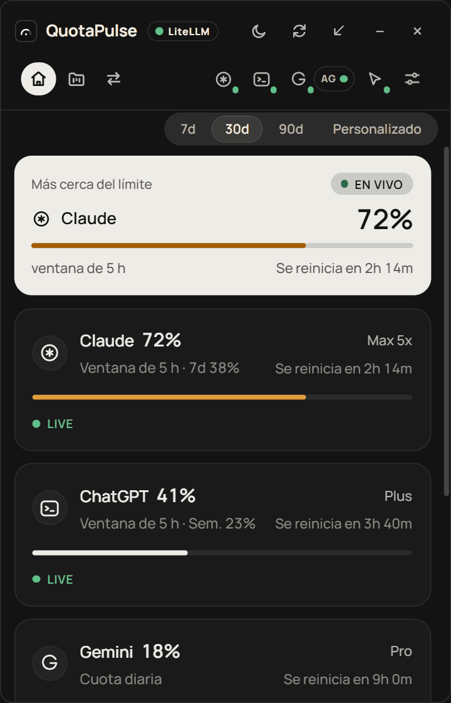

<div align="center">


# QuotaPulse

**Real-time AI quota monitor for Windows, macOS and Linux — every plan's remaining usage and reset time, at a glance.**
Claude Code · ChatGPT / Codex CLI · Gemini · Cursor · LiteLLM Proxy

**English** · [Español](README.es.md)

[](LICENSE)
[](https://github.com/DennisRom001/QuotaPulse/releases/latest)
[](#installation)
[](https://github.com/DennisRom001/QuotaPulse/actions/workflows/ci.yml)
[](https://tauri.app)

</div>

<p align="center">
  
  <br />
  <sub>Demo recorded with sample data.</sub>
</p>

---

If you use several AI coding tools at once, you have probably been cut off mid-task because a 5-hour window ran out, or opened three dashboards just to see where you stand. QuotaPulse puts every plan in one small window — or a floating capsule at the top of your screen — so you always know how much is left and when it resets.

- **Native and light.** Tauri 2 + Rust + React. The Rust core uses about 30 MB of memory; the UI runs on the system web view (WebView2 on Windows, WKWebView on macOS, WebKitGTK on Linux) instead of a bundled Chromium.
- **100% local, no telemetry.** It reuses the sessions your CLIs already have on this machine and talks **directly** to each provider's official API. No account, no QuotaPulse server, no middleman.
- **Real numbers only.** A percentage on screen is exactly what the provider reported. When there is no live figure, QuotaPulse says so instead of drawing a fake 0% bar.

## Supported providers

| Provider | What QuotaPulse shows | Where it comes from |
|---|---|---|
| **Claude Code** | 5-hour and 7-day windows, live | `api.anthropic.com`, using Claude Code's own login |
| **ChatGPT / Codex CLI** | Session and weekly usage, live | `chatgpt.com`, using the `codex login` session |
| **Gemini** | Antigravity (live) → Gemini CLI quota → Google AI Studio key → Gemini desktop app | Local Antigravity server, Google Code Assist, AI Studio |
| **Cursor** | Plan usage when the editor session is readable; otherwise local activity and a calibrated estimate (always marked `~`) | `cursor.com` and Cursor's local state, read-only |
| **LiteLLM Proxy** | Tokens, spend and budgets per provider (`LIVE — LITELLM`) | Your local proxy on `127.0.0.1` |

## Key features

- **Floating capsule.** A compact ink pill that stays on top near the top of the screen, with one monogram per AI, its status dot and a thin bar only when a real figure exists. Drag it anywhere; it remembers its position. Click it to show or hide the main window. On Windows, while it is on, the main window stays off the taskbar. On macOS and Linux it opens below the menu bar or top panel. It can be turned off in Settings.
- **Clean, low-noise design.** Warm paper surfaces, white cards, one ink block for the quota closest to its limit, 4 px progress bars and tabular figures. Light and dark themes, a custom thin-stroke icon set and geometric provider monograms. Built for a 360 px window, with a compact widget mode.
- **Honest states.** `LIVE`, `ACTIVE`, `LOCAL — AUTH EXPIRED` and so on are shown as reported. Estimates carry a `~` and use a neutral grey; bars turn amber at 70% and red at 90%.
- **Real time without burning resources.** One native, debounced file watcher, and at most one live API call per provider every 30 seconds.
- **Threshold alerts and limit forecasts.** Desktop notifications when a quota crosses your thresholds, plus an estimate of when it will run out.
- **Budgets and history.** Estimated tokens and cost from the local logs of Claude Code, Codex CLI and Gemini CLI, kept for up to 90 days, with project, session and provider-comparison views.
- **Export.** CSV, JSON, or an HTML report ready for *Print to PDF*.
- **Desktop citizen.** Tray / menu-bar icon, start at login, one-click sign-in for Claude Code and Codex CLI (opens `claude auth login` / `codex login` in a terminal: a console on Windows, Terminal.app on macOS, your terminal emulator on Linux) and signed automatic updates.
- **Interface language:** the UI is currently in Spanish.

## Privacy & security

- **Read-only credentials.** QuotaPulse reads each tool's existing login files and never modifies, refreshes or stores your credentials.
- **Closed HTTPS allowlist.** Network calls go only to official hosts — `api.anthropic.com`, `chatgpt.com`, `cloudcode-pa.googleapis.com`, `generativelanguage.googleapis.com` and `cursor.com` — over HTTPS, with proxies and redirects disabled.
- **Local services stay local.** Antigravity and LiteLLM are only contacted on `127.0.0.1`.
- **Signed updates.** Updates come from GitHub Releases, and every package is verified against the public key built into the app before it is installed. The startup check can be turned off in Settings.
- **No telemetry, no analytics.**

## Installation

Download the installer for your system from the [latest release](https://github.com/DennisRom001/QuotaPulse/releases/latest). No Node.js or Rust needed. Later versions install themselves (Settings → About → *Buscar actualizaciones*).

| System | Download | Notes |
|---|---|---|
| **Windows 10/11** | `QuotaPulse_x.y.z_x64-setup.exe` (or `.msi`) | Run it; WebView2 is included. |
| **macOS 10.15+** (Apple silicon and Intel) | `QuotaPulse_x.y.z_universal.dmg` | Drag QuotaPulse to Applications. The app is not notarized — see below. |
| **Linux** (x86-64, glibc 2.35+ e.g. Ubuntu 22.04+) | `QuotaPulse_x.y.z_amd64.AppImage` or `.deb` | See below. |

**macOS — first launch of an app that is not notarized.** QuotaPulse is ad-hoc signed but not notarized by Apple (that needs a paid developer account), so macOS blocks the first launch. Either open **System Settings → Privacy & Security** and click **Open Anyway** next to the QuotaPulse message, or remove the quarantine flag once:

```bash
xattr -dr com.apple.quarantine /Applications/QuotaPulse.app
```

**Linux — AppImage or .deb.**

```bash
chmod +x QuotaPulse_*_amd64.AppImage
```

```bash
./QuotaPulse_*_amd64.AppImage
```

or install the package (pulls in WebKitGTK automatically):

```bash
sudo apt install ./QuotaPulse_*_amd64.deb
```

On GNOME the tray icon needs the *AppIndicator* extension; KDE, Xfce and most other desktops show it out of the box.

Install whichever tools you want to monitor: Claude Code, Codex CLI, Gemini CLI, Antigravity or Cursor.

### Platform notes

macOS and Linux builds are new: they compile and pass the test suite on GitHub Actions for every change, but have had less real-world use than the Windows build. Differences today:

- **LiteLLM auto-start** (`start-litellm.bat`) is Windows-only; on macOS and Linux, start the proxy yourself and QuotaPulse reads it the same way.
- **Gemini desktop app** detection is Windows-only; every other Gemini source works everywhere.
- **Per-provider tray badges** are drawn on Windows and in the macOS menu bar; Linux shows the app icon (AppIndicator has no per-icon images or click events — use its menu).
- **Reading environment variables from the user environment** (`setx`) is Windows-only; on macOS and Linux set them before launching QuotaPulse.

## Optional: LiteLLM Proxy

`start-litellm.bat` creates an isolated `.venv` next to the script, installs pinned, hash-verified `litellm[proxy]` packages and starts the proxy on `127.0.0.1:4000`. On Windows, QuotaPulse launches it automatically and windowless when the port is closed, using a random per-install master key stored in Windows Credential Manager. Requires Python 3.10–3.14. Set `QP_DISABLE_LITELLM=1` to turn this off.

On macOS and Linux, run the proxy yourself on `127.0.0.1:4000` (for example `litellm --port 4000`) and set `LITELLM_API_KEY` if it requires a key.

For LiteLLM to report spend per provider it needs configured models and a database — see the LiteLLM documentation.

## Configuration

Every setting is optional and documented in [`.env.example`](.env.example) (names only, never values). On Windows, QuotaPulse also reads your user environment, so `setx` works without restarting the app:

```powershell
setx QP_DISABLE_LITELLM 1
```

## Build from source

### Prerequisites

- **All systems:** Node.js 20+ and npm, and stable **Rust** from [rustup.rs](https://rustup.rs/).
- **Windows:** Visual Studio Build Tools with the *Desktop development with C++* workload.
- **macOS:** Xcode Command Line Tools (`xcode-select --install`).
- **Linux (Debian/Ubuntu):**

```bash
sudo apt install libwebkit2gtk-4.1-dev libayatana-appindicator3-dev librsvg2-dev patchelf libdbus-1-dev libssl-dev build-essential
```

### Steps

```bash
git clone https://github.com/DennisRom001/QuotaPulse.git
```

```bash
cd QuotaPulse
```

```bash
npm install
```

```bash
npm run tauri build
```

The app and installers land in `src-tauri/target/release/bundle/`. Use `npm run tauri dev` for development. Signing, releasing and useful paths are in [BUILDING.md](BUILDING.md); the architecture is in [ARCHITECTURE.md](ARCHITECTURE.md).

## License

[MIT](LICENSE).
